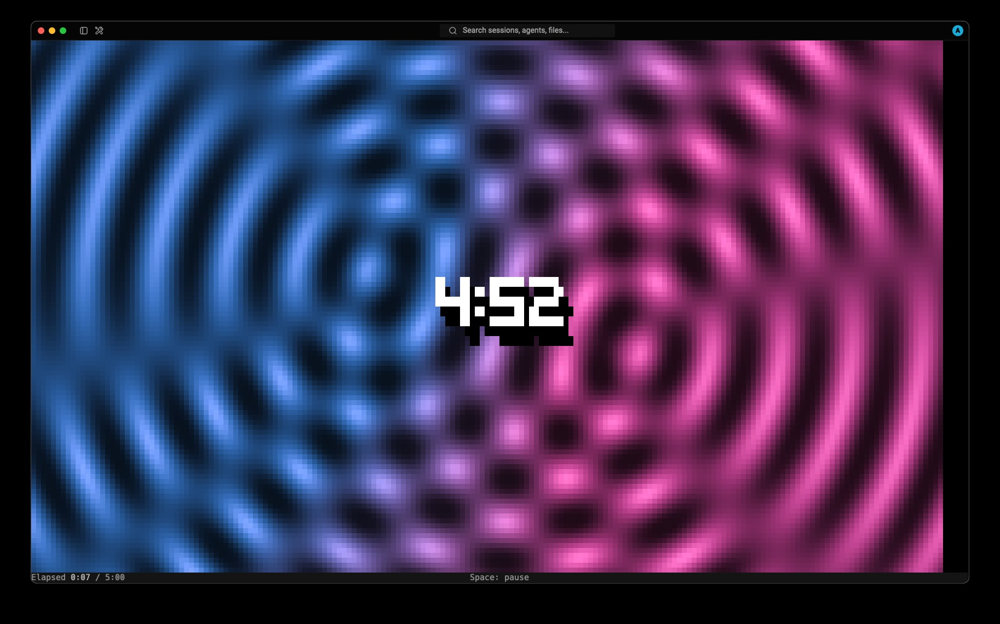
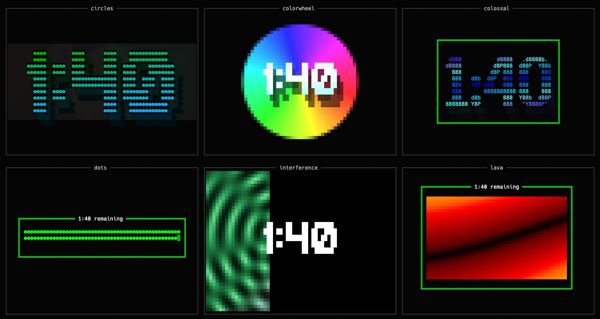

# Pace

[](https://www.rust-lang.org/)
[](https://github.com/swartzrock/pace-timer/actions/workflows/ci.yml)
[](https://github.com/swartzrock/pace-timer/commits/main)
[](LICENSE)

<!-- Enable these badges after publishing the first GitHub release:
[](https://github.com/swartzrock/pace-timer/releases)
[](https://github.com/swartzrock/pace-timer/releases)
-->

**A visual countdown timer for your terminal.**

Set a duration, choose an animated display, and watch the time pass. Pace includes
14 visual styles, from a simple progress bar to waves, auroras, and lava. Leave
the choice to `shuffle` to switch styles every ten seconds.

Written in Rust, with fonts and colors bundled into a single executable.

[](assets/interference.jpg)

## Install

With Git and a current stable [Rust toolchain](https://rustup.rs/) installed:

```sh
git clone https://github.com/swartzrock/pace-timer.git
cd pace-timer
cargo install --path . --locked
pace 5m
```

Run Pace in an interactive terminal. For the richest colors, use a terminal with
true-color support.

## Usage

```sh
pace 5m                  # Shuffle through the visual styles
pace 3m10s pie           # Pick a style
pace 2.5m interference   # Decimal minutes work too
pace preview             # Browse the renderer gallery
```

Press **Space** to pause or resume, and **Ctrl-C** to quit. Durations accept
minutes and seconds: `5m`, `30s`, `3m10s`, or `2.5m`.

Choose from `aurora`, `bar`, `bigtext`, `circles`, `colorwheel`, `colossal`,
`dots`, `interference`, `lava`, `pie`, `sine`, `slant`, `sweep`, and `tide`,
or use `shuffle` (the default).

[](assets/preview.jpg)


Colors adapt to your terminal automatically. Override with
`--color-depth truecolor`, `256`, `16`, or `1` (monochrome).
Automatic detection honors `NO_COLOR`; an explicit color depth overrides it.
Add `--show-fps` to display the draw rate, or run `pace --help` for all options.

## Contributing

[Issues and renderer ideas](https://github.com/swartzrock/pace-timer/issues) are
welcome. To check a change locally:

```sh
cargo test --locked --all-targets
cargo fmt --check
cargo clippy --locked --all-targets -- -D warnings
```

## License

[ISC](LICENSE). Pace is a Rust port of the [original TypeScript app](https://github.com/swartzrock/pace).
Bundled font credits and FIGlet.js notices are in [assets/](assets/README.md).
