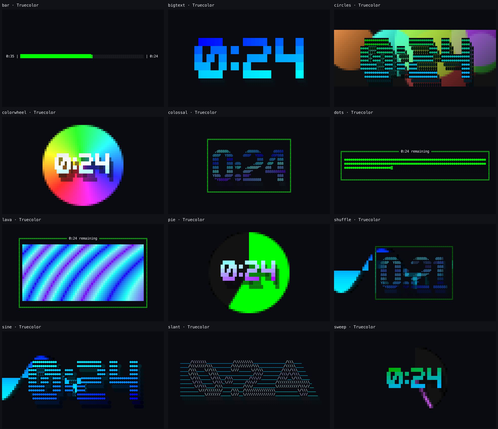

# Pace, in Rust

A standalone Rust port of [Pace](https://github.com/swartzrock/pace), the visual
terminal countdown timer. The TypeScript source remains in the sibling
`pace-ts` folder; this project builds and runs independently.

The port targets 60 frames per second with buffered terminal updates. Animation
and countdown progress use elapsed time rather than frame counts, so delayed
frames do not speed up effects or lengthen the timer. Missed frames are skipped.

## Run

With Rust and Cargo installed, run these commands from this folder:

```sh
cargo run --release -- 5m shuffle
cargo run --release -- 3m10s pie
cargo run --release -- timer 2.5m lava
cargo run --release -- 1m:sine
```

To build a standalone executable:

```sh
cargo build --release
./target/release/pace 5m shuffle
```

On Windows the executable is `target\release\pace.exe`. The countdown requires
an interactive terminal. Press **Space** to pause or resume and **Ctrl-C** to exit.
Fonts and color data are compiled into the executable; Node and external font
files are not required.

## Color and FPS

```sh
./target/release/pace 1m lava --show-fps
./target/release/pace 1m colorwheel --color-depth truecolor
./target/release/pace 1m pie --color-depth 256
./target/release/pace 1m sine --color-depth 16
./target/release/pace 1m bigtext --no-color
./target/release/pace tools preview --color-depth truecolor
```

`--color-depth auto|truecolor|256|16` defaults to `auto`. Auto uses positive
`COLORTERM=truecolor|24bit` or direct-color `TERM` hints for RGB, a 256-color
hint for indexed color, recognized ANSI terminals for 16 colors, and otherwise
monochrome. `TERM=dumb` uses monochrome. SSH and tmux can hide capability hints;
force a depth when you know the full terminal connection supports it.

`--no-color` always wins. Otherwise an explicit non-auto depth wins over
nonempty `NO_COLOR` and enables colored output in pipes. Auto honors `NO_COLOR`
and makes redirected tools monochrome. Flags can appear before or after operands;
each flag may appear once. Both foreground and background use the selected depth.

`--show-fps` is optional and timer-only. Its bottom-right label measures successful
completed draws per second, including terminal I/O and scheduled waiting over a
roughly one-second window. It measures the draw loop rather than the terminal
emulator's screen painting. `FPS --` means warming up; `FPS paused` means paused.
Resuming starts a fresh window. Narrow terminals hide labels that cannot fit,
and a one-row terminal prioritizes the countdown over the footer.

## Renderers and tools

All 12 original renderer names are available: `bar`, `bigtext`, `circles`,
`colorwheel`, `colossal`, `dots`, `lava`, `pie`, `shuffle`, `sine`, `slant`, `sweep`.
The default, `shuffle`, changes renderer every ten active seconds and wipes into
the next renderer over the last 2.5 seconds of each slot.

Pixel effects use foreground/background halfblocks for finer vertical detail.
Lava interpolates its height maps and palettes; colorwheel rotates continuously;
pie and sweep have softer contours; circles add lighting and generation fades;
sine includes a shaded trailing wave. Bar and dots show fractional segments.
The three text renderers retain their fonts and stable sizing with richer shading
and soft shadows. Shuffle feathers backgrounds while keeping one complete countdown.



```sh
cargo run --release -- tools preview
cargo run --release -- tools allfonts
cargo run --release -- tools colorblocks
cargo run --release -- tools version
cargo run --release -- --help
```

The font catalog includes all 289 original fonts. Its layout is checked against
306 original FIGlet.js outputs. Source font notices and the FIGlet.js license are
preserved under `assets/`.

The documented decimal duration form (`2.5m`) now means 150 seconds; the old
parser accidentally interpreted it as five minutes. Invalid duration text
produces a usage error. Remaining seconds retain the original rounding down.
Animation freezes while paused, including lava, which previously used wall time.

## Verify

```sh
cargo test --all-targets
cargo fmt --check
cargo clippy --all-targets -- -D warnings
cargo build --release
```

On macOS or Linux, exercise the binary in a pseudo-terminal, including all
renderers, pause/resume, resize, Ctrl-C, SIGTERM, and terminal restoration:

```sh
python3 tests/terminal_smoke.py target/release/pace
```

Measure warmed frame preparation separately from terminal output:

```sh
cargo test --release --test renderers measure_frame_preparation -- --ignored --nocapture
python3 -B tests/terminal_measure.py target/release/pace
```

The Rust measurement reports initial render work, warmed composition, and final
color adaptation separately. The PTY measurement reports observed completed-write
cadence and output bytes, including a shuffle transition. Neither measures emulator
painting. Visible smoothness depends on terminal size, emulator,
and font settings. For a visual check, run `1m sine`, `1m lava`, and `2m shuffle`;
pause, resume, and resize the window while they run.

## License

ISC, as in the original Pace project. Bundled font notices and the MIT license
for the ported FIGlet.js layout rules are in `assets/`.
