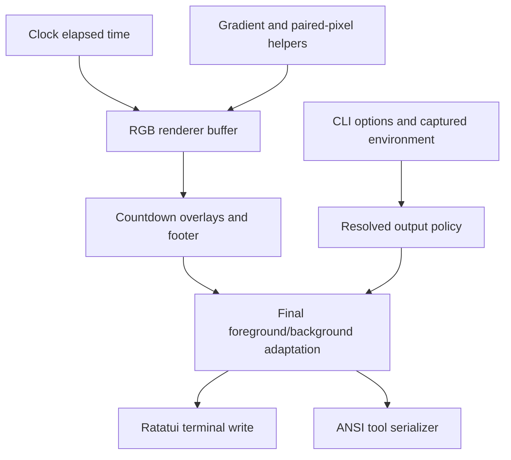
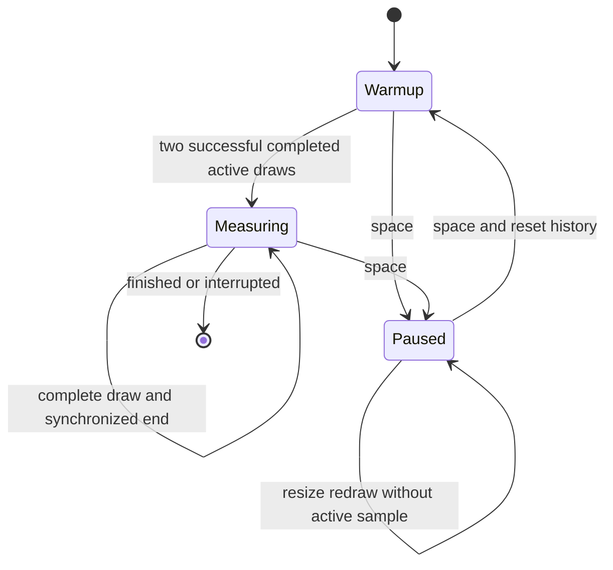

# Adaptive Terminal Visuals and FPS - Plan

## Goal Capsule

- Objective: Pace users see smoother, richer countdown animations in their terminal and can inspect the delivered frame rate when requested.
- Means: Extend the existing renderers through shared RGB, color adaptation, and halfblock primitives (KTD1-KTD4).
- Authority: The requested visual improvements and compatibility requirements below govern implementation; implementation choices may change within those requirements.
- Execution profile: Two dependent implementation phases, each delivered as a verified branch and pull request before the next starts.
- Stop conditions: A broken compatibility invariant, failing required checks that cannot be repaired in scope, or a destructive action requiring user approval.
- Completion owner: The implementing workflow verifies and ships both phases without waiting for manual terminal testing.

---

## Product Contract

### Summary

Upgrade every existing renderer with finer shapes, continuous color, or smoother motion appropriate to its identity.
Adapt the resulting colors to terminal capabilities and provide an optional bottom-right FPS display.

### Problem Frame

Pace already prepares frames quickly, but indexed palettes, rounded cell coordinates, coarse sampling, and stepped rotation limit what viewers see.
The current measurements exclude terminal writes, so they cannot tell users the delivered frame rate.

### Key Decisions

- Adaptive color preserves terminal compatibility (session-settled: user-approved — chosen over forcing RGB on every terminal: richer color should retain a fallback for limited terminals). Governs R1-R3.

### Requirements

**Color and compatibility**

- R1. Auto mode selects truecolor when the environment advertises support and otherwise falls back to 256, 16, or monochrome output without blocking startup probes.
- R2. Add `--color-depth auto|truecolor|256|16` and `--no-color`, with explicit output choices taking precedence over automatic detection and nonempty `NO_COLOR` disabling automatic color.
- R3. Generate and blend richer RGB colors before quantizing at the output boundary; apply the same policy to timer and tool output.
- R4. Preserve all 12 renderer names, existing timer/tool command forms, minute/second duration syntax, pause/resume, resize, terminal restoration, and countdown readability.

**Visual refinement**

- R5. Use foreground/background halfblocks for two vertical samples per cell and antialiased edges where the renderer draws pixel-like shapes.
- R6. Lava uses bilinear map sampling and continuously interpolated, evolving color palettes.
- R7. Colorwheel uses continuous hue and elapsed-time rotation rather than legacy 100ms steps.
- R8. Pie and sweep gain finer circular contours and a smooth hand or sweep boundary.
- R9. Circles gain soft edges, lighting, and continuous generation fades.
- R10. Sine gains subcell wave placement, shaded edges, and a subtle trail.
- R11. Bar and dots show fractional progress within their last occupied segment.
- R12. Bigtext, colossal, and slant gain richer gradients and softer shadows while preserving stable, crisp digit shapes.
- R13. Shuffle uses a feathered wipe while retaining the 10-second renderer interval and 2.5-second transition.

**Timing and presentation**

- R14. Retain the 60 FPS scheduling target and measure terminal output cost alongside preparation cost without claiming emulator painting is measurable.
- R15. Add `--show-fps`, off by default, showing actual successfully completed terminal frames per second over a trailing window, including I/O and scheduled waiting.
- R16. FPS is bottom-right with explicit initial and paused states, and footer layout preserves the countdown and avoids status collisions in narrow terminals.
- R17. Help, README examples, automated verification, and useful CI checks cover the new controls and compatibility behavior.

### Acceptance Examples

- AE1. Covers R1-R3. With `TERM=xterm-256color` and `COLORTERM=truecolor`, auto emits RGB; with only the former it chooses 256 colors. A forced truecolor setting works even when auto would choose a lower depth.
- AE2. Covers R2-R3. With nonempty `NO_COLOR`, default timer and tools emit no nondefault foreground/background color selections. `--color-depth truecolor` explicitly enables RGB, while `--no-color` takes priority over either selection.
- AE3. Covers R15-R16. Initial display says `FPS --`; completed frames spaced about 33ms apart yield approximately 30 FPS. Pausing shows `FPS paused` without continuing animation, and resuming starts a fresh sample window.
- AE4. Covers R4, R16. Resizing to 12x1 keeps the countdown readable and omits the footer; resizing back restores the enabled FPS/footer without overwriting animation cells.
- AE5. Covers R5-R13. Frames less than 100ms apart can differ during continuous movement, while paused elapsed time produces unchanged animation geometry.

### Scope Boundaries

No new renderers, image protocols, themes/config files, asynchronous renderer architecture, server, font parser rewrite, or asset replacement.
Preserve the 289-font catalog and 306 FIGlet fixture outputs.
Active terminal capability queries are considered and not built: they consume terminal input and add startup latency for a preference that has explicit overrides.
An emulator painting benchmark is considered and not built because the synchronous backend can establish completed writes, not presentation timestamps.

---

## Planning Contract

### Assumptions

These unconfirmed technical defaults fill details the request leaves open: flags may occur before or after timer operands, `--show-fps` is timer-only, repeated singleton flags are errors, and `--color-depth=VALUE` may be accepted alongside the space-separated form.
Unknown output capability uses monochrome for `TERM=dumb` or absent terminal identity, 256 for an explicit 256-color hint, and 16 for recognized basic ANSI terminal identities.
Auto tool output redirected to a pipe uses monochrome, while an explicit depth opts back into color.
These choices should remain documented and testable; exact internal helper names and shading constants remain implementation details.

### Key Technical Decisions

- KTD1. Resolve one immutable output policy at startup from parsed options, terminal status, and a captured environment. Implement the precedence in AE2 as a pure decision function, making process-global environment mutation unnecessary in tests. Under R1, `COLORTERM=truecolor|24bit` and explicit direct-color TERM identities are positive hints, while `xterm-256color` alone is a 256-color hint, never negative evidence against another RGB hint. Treat missing hints over SSH/tmux conservatively and document the explicit override. `TERM_PROGRAM`, `TMUX`, and `SSH_*` identify context, not proof of end-to-end RGB support. This instantiates R1-R3 (session-settled: user-approved — chosen over forcing RGB on every terminal: richer color should retain a fallback for limited terminals).
- KTD2. Keep renderer buffers in RGB and adapt both foreground and background immediately before terminal draw or tool serialization. Convert legacy indexed palette stops to RGB once, interpolate there, and quantize with deterministic nearest-palette mapping for 256 and named ANSI colors for 16. Monochrome retains text/shape glyphs with default terminal colors and uses luminance-based glyph coverage for pixel samples. This satisfies R3 without threading terminal capability through each effect.
- KTD3. Add small shared RGB interpolation, continuous gradient, coverage, and paired-pixel helpers in the existing graphics boundary. Paired pixels encode upper/lower samples into a halfblock with foreground and background, clip to the supplied viewport, and handle transparent/background samples explicitly. Preserve crisp font masks and composite their shadows before final color adaptation (R5, R12).
- KTD4. Render incompatible shuffle glyphs by selecting a source glyph across a narrow feather band and blending its colors with the local destination colors. Blend both colors directly where symbols match. Never invent alpha compositing between unrelated glyph shapes; preserve exact source/destination endpoints and countdown overlays under R13.
- KTD5. Timestamp a frame only after `Terminal::draw` and `EndSynchronizedUpdate` both succeed. Keep a bounded, approximately one-second history of completion intervals, retaining the interval crossing the window edge so a slow draw is represented. Compute interval count divided by actual elapsed wall time, not target frequency or reciprocal preparation duration. The HUD displays the previous completed history because its own completion is unknowable until after drawing (R14-R15).
- KTD6. The FPS tracker has warmup, measuring, and paused states. Clear its history on pause/resume so no paused duration pollutes active cadence. Dirty paused resize draws do not enter the active sample history. With fewer than two completed active frames show the AE3 initial state, and do not schedule paused redraws merely to update FPS (R15-R16).
- KTD7. Compose one footer row when status or FPS needs it and height permits. Allocate the rightmost FPS field first, clip status into the remaining left region, and hide status when no useful region remains. Omit FPS when its whole label cannot fit and omit the entire footer at height one. Apply the paused overlay to the content viewport before composing the footer (R4, R16).
- KTD8. Keep the synchronous `FrameSchedule`, cached lava maps, seeded renderer tests, and reusable transition buffer. Add no alternate rendering framework or dependency unless implementation proves an existing dependency cannot meet a requirement. Environment hints plus explicit policy are a straightforward extension, so they do not require a competing implementation bake-off.

### High-Level Technical Design

Color data flow and component boundaries:

Completed-frame lifecycle and FPS states:

Policy selection follows this ordered decision table; the first applicable row wins:

| Input | Output |
| --- | --- |
| `--no-color` | Monochrome |
| Explicit non-auto `--color-depth` | Requested depth |
| Nonempty `NO_COLOR` | Monochrome |
| Auto redirected tool stdout | Monochrome |
| Auto `TERM=dumb` | Monochrome |
| Auto positive RGB hint | Truecolor |
| Auto 256/basic/unknown capability | KTD1 and Assumptions fallback |

### Delivery Phases and Boundaries

Phase 1 delivers U1-U4 on `feat/adaptive-color-fps`, based on `main`, including this plan.
Phase 2 delivers U5-U6 on `feat/smooth-renderers`, based on the phase 1 branch.
Each phase is implemented, verified, committed, pushed, and opened as a PR before moving to the next; later PR CI must run for the actual stacked base as well as `main`.

Before phase 2 begins, freeze these shared responsibilities: RGB palette conversion and interpolation; foreground/background color adaptation; clipped paired-pixel placement; and existing `Renderers::render`/elapsed-time access.
Effect and text-renderer work can then use those primitives independently.
One integrator owns shared file reconciliation, final output conversion, and the combined verification result.

### System-Wide Impact and Risks

The CLI, interactive renderer, and raw ANSI tools form distinct output paths; none may bypass the resolved policy.
`tools::write_buffer` currently understands only indexed foreground, so RGB and background serialization are required before halfblock preview output is correct.
`gradient_text` and `color_blocks` also write ANSI directly and need policy adaptation.

Environment hints cannot prove every SSH/multiplexer hop or custom terminal palette.
The override and documented conservative defaults handle that uncertainty without probing.
Named 16-color values are theme-dependent, so prioritize contrast and geometry rather than promising exact colors there.

Spatial refinement increases terminal diff bytes even when preparation remains cheap.
Measure preparation and complete write cadence separately under R14, retaining the target rather than promising every terminal can sustain it.
Replace tests that lock obsolete indexed colors, doubled disk columns, or the hard wipe seam with semantic geometry/continuity checks; retain source font snapshots unchanged.

### Sources and Existing Patterns

- `src/terminal.rs`: `compose`, synchronized draw completion, dirty paused redraws, and footer reservation.
- `src/model.rs`: monotonic `Clock`, `TimerDetails`, and skip-late `FrameSchedule`.
- `src/effects.rs`: cached lava fields, disk geometry, circle state, and existing continuous sine movement.
- `src/renderers.rs`: font masks, stable bigtext scaling, renderer identities, and reusable shuffle buffer.
- `src/tools.rs`: the separate raw ANSI serialization path.
- [Terminal color detection](https://github.com/termstandard/colors#truecolor-detection) supports environment hints with conservative fallback and explicit override.
- [tmux RGB guidance](https://github.com/tmux/tmux/wiki/FAQ#how-do-i-use-rgb-colour) explains the inner/outer terminal distinction behind KTD1.
- [Ratatui 0.30.2 Color](https://docs.rs/ratatui/0.30.2/ratatui/style/enum.Color.html) provides RGB, indexed, and named colors for KTD2.
- `docs/verification.md` contains historical preparation-only timings; new measurements must identify their different scope rather than presenting those as delivered FPS.

---

## Implementation Units

### U1. Adaptive policy, CLI options, and tool output

- Goal: Make every output path honor R1-R4 and R17.
- Dependencies: None.
- Files: Add `src/color.rs` and `tests/color.rs`; modify `src/lib.rs`, `src/cli.rs`, `src/main.rs`, `src/tools.rs`, `tests/cli.rs`, and tool-local tests.
- Approach: Implement KTD1-KTD2 policy and palette conversion, extend the manual parser without changing duration parsing, and route all direct ANSI helpers through the resolved output policy. Preserve tool content and catalog names. Support foreground and background in buffer serialization and avoid redundant escape sequences between unchanged styles.
- Patterns: Existing `Command`, strict duration errors, buffered tool stdout, and `tests/cli.rs` process invocation.
- Execution note: Characterize legacy command forms before changing the parser.
- Test scenarios:
  1. Covers AE1-AE2. Exercise the full precedence table with captured environments, including empty `NO_COLOR`, missing hints, contradictory TERM/COLORTERM, SSH, tmux, and explicit depth.
  2. Every legacy command form still parses; missing/invalid depth, duplicate singleton flags, unknown flags, and tool-only misuse of FPS return clear errors.
  3. Truecolor serialization emits RGB foreground and background; 256 and 16 paths emit only their selected depth; monochrome preserves symbols without nondefault color selection.
  4. Redirected preview/allfonts/colorblocks use the auto pipe policy, while explicit depth restores color and `--no-color` removes it throughout.
- Verification: Policy tests are deterministic and existing CLI compatibility tests pass.

### U2. RGB and paired-pixel rendering foundation

- Goal: Establish reusable primitives for R3, R5 and later renderer units.
- Dependencies: U1.
- Files: `src/graphics.rs`, `src/palette.rs`, `src/terminal.rs`, `tests/graphics.rs` (new), and relevant `tests/renderers.rs` assertions.
- Approach: Implement KTD2-KTD3. Keep compatibility wrappers where existing renderer calls still use palette indices, converting those stops into RGB rather than quantizing new gradients early. Connect final buffer adaptation to terminal composition and the U1 tool path before phase 2 uses halfblocks.
- Patterns: Existing viewport-relative clipped `put`, `text`, `centered_text`, and `Buffer` composition.
- Test scenarios:
  1. Two differing vertical samples produce one halfblock cell with distinct foreground/background colors; equal samples preserve a solid result.
  2. Interpolation endpoints and midpoints are continuous; indexed palette conversion covers the ANSI, cube, and grayscale ranges.
  3. Pixel placement in zero-size, 1x1, odd-height, and offset viewports never writes outside the supplied area.
  4. Covers R3. The same RGB buffer adapts into each selected output depth without leaking RGB into lower-depth output or losing background pixels.
  5. Monochrome text and pixel geometry remain visible using default colors and structural glyph coverage.
- Verification: Both timer and tools can display paired-pixel buffers, and countdown tests remain readable.

### U3. Completed-frame FPS and footer layout

- Goal: Deliver R14-R16 using the existing synchronous loop.
- Dependencies: U1-U2.
- Files: `src/model.rs` or a small dedicated `src/fps.rs`, `src/terminal.rs`, `src/main.rs`, `src/lib.rs` if needed, `tests/clock.rs`, terminal-local tests, and `tests/terminal_smoke.py`.
- Approach: Implement KTD5-KTD7 with injected timestamps in tracker tests. Record only successful full draws; retain existing signal and error restoration. Pass the prior completed-frame snapshot into composition so HUD painting does not count itself prematurely.
- Patterns: `Clock`, `FrameSchedule`, post-draw `Instant::now`, and `small_terminal_keeps_readable_countdown_alongside_status`.
- Test scenarios:
  1. Covers AE3. First frame, regular 60/30 FPS timestamps, irregular intervals, and a slow completion produce measured rather than target values.
  2. Window expiration, zero-duration intervals, and a long draw do not produce infinities or erase the slow interval.
  3. Pause/resume resets history; paused resize draws leave active sample count unchanged; failed draw/end-update does not record a completion.
  4. Covers AE4. Test status plus FPS at widths 1, 8, 12 and 80 and heights 1, 2 and 24, including offset rectangles and a paused overlay.
  5. Default invocations show no FPS; enabled PTY invocations show warmup/measuring/paused behavior and still restore terminal modes after completion, interruption, and resize.
- Verification: Deterministic tracker tests prove timing math; PTY tests prove actual CLI-to-terminal integration without strict host-dependent FPS assertions.

### U4. Foundation documentation and CI

- Goal: Document R1-R4 and R14-R17 and provide real checks for both stacked PRs.
- Dependencies: U1-U3.
- Files: `README.md`, `src/cli.rs` help, `docs/verification.md`, `.github/workflows/ci.yml` (new), and `tests/cli.rs`.
- Approach: Document depth precedence, multiplexer/SSH limits, no-color, FPS semantics and examples. Add focused stable-Rust CI on Ubuntu and macOS for tests and release PTY smoke; formatting and strict Clippy can run once on Ubuntu. Trigger on all pull requests so stacked bases receive checks. Preserve historical verification context while adding clearly dated current results.
- Test scenarios:
  1. Help exposes exact supported flag values and shows legacy examples alongside `--show-fps`.
  2. Workflow executes nonempty checks for a PR targeting a feature branch as well as `main`.
  3. CI smoke uses the executable actually built in that job and runs the existing Unix PTY restoration coverage.
- Verification: Documented examples match parser tests; the phase 1 PR has observable successful CI checks.

### U5. Smooth field and geometric effects

- Goal: Deliver R5-R11 across the field, geometric and progress effects.
- Dependencies: U1-U4; phase 1 shared boundaries frozen.
- Files: `src/effects.rs`, `tests/effects.rs`; shared helpers only through the integrator if a missing primitive is proven.
- Approach: Keep cached lava maps and bilinearly sample neighboring entries with correct map bounds. Interpolate palette stops and evolve their phase continuously. Compute wheel hue/angle from elapsed time. Use paired samples and coverage for disks, hands, circles and waves. Derive the sine trail from earlier elapsed-time samples so pause behavior and seeded repeatability need no frame-history cache. Blend circle generation brightness continuously across its existing lifecycle. Use fractional segment coverage for bar/dots while retaining their single-line and grid identities.
- Patterns: Existing seeded `Effects`, cached maps, aspect correction, elapsed-time state, and clipping tests.
- Test scenarios:
  1. Covers R6. Bilinear samples match exact map points and interpolate interior/boundary positions; palette output changes continuously across a previous discrete stop and over time.
  2. Covers R7. Wheel frames 16ms apart show changed orientation/color before a legacy tick and remain stable for repeated elapsed time.
  3. Covers R8. Pie/sweep endpoints at zero/full progress, antialiased contour coverage, and subcell hand movement preserve their identity and countdown region.
  4. Covers R9. Circle edge and lighting samples show partial coverage, and generation boundaries avoid a brightness jump.
  5. Covers R10. Sine subcell movement, edge coverage, faint trailing samples, and repeated paused time behave deterministically.
  6. Covers R11. Bar/dots zero/full states remain exact, and progress within one segment changes its partial coverage monotonically.
  7. All eight effects remain clipped at 1x1 and offset viewports and maintain useful shapes after lower-depth and monochrome adaptation.
- Verification: Semantic geometry/continuity checks replace representation locks, and controlled frames visibly retain each renderer's identity.

### U6. Text shading and feathered shuffle

- Goal: Deliver R12-R13 and complete integrated visual verification.
- Dependencies: U1-U4; U5 is required for final combined verification but may be developed independently.
- Files: `src/renderers.rs`, `tests/renderers.rs`, `tests/fonts.rs` only if adding mask-preservation assertions, `tests/terminal_smoke.py`, and `docs/verification.md`.
- Approach: Shade existing font masks and layered shadows without modifying font parsing or scaling. Implement KTD4 in the reusable shuffle buffer, keeping readable countdown text above the transition.
- Patterns: Stable `55:55` reference scaling, existing shadow placement, seeded renderer constructor, and current shuffle boundary tests.
- Test scenarios:
  1. Text gradients and shadows change color smoothly while glyph masks remain crisp; digit changes do not alter scale or alignment.
  2. Existing 306 font fixtures pass byte-for-byte without asset/parser changes.
  3. Shuffle at transition start/end equals the appropriate source/destination; mid-transition feather contains a local mixture without a hard one-column seam.
  4. Different symbols select a valid source glyph, matching symbols blend both colors, and resize during transition replaces stale-sized buffers safely.
  5. Covers R13. Verify the 10-second switch and 2.5-second duration, including pause across a boundary and readability of the final countdown.
- Verification: All renderer and PTY checks pass together, preparation and output measurements are recorded separately, and the phase 2 PR has successful CI.

---

## Verification Contract

| Check | Scope | Required evidence |
| --- | --- | --- |
| `cargo test --all-targets` | Every phase | Existing compatibility/font tests plus the new unit and integration cases pass |
| `cargo fmt --check` | Every phase | No formatting changes required |
| `cargo clippy --all-targets -- -D warnings` | Every phase | No warnings |
| `cargo build --release` | Every phase | Release executable builds |
| `python3 tests/terminal_smoke.py target/release/pace` | Every phase | All renderers, pause/resume, resize, signals, and terminal restoration pass |
| Existing ignored release measurement plus output-cadence measurement | Phase 2 | Warm 120x40 preparation remains below 16.7ms per frame; report actual completed write cadence and output bytes separately without a universal 60 FPS claim |
| Controlled buffer inspection and terminal manual instructions | Phase 2 | Representative RGB/256/16/mono frames and each visual refinement are reviewable; manual emulator appearance is identified as a remaining human check |
| GitHub PR checks | Each PR | At least the new Rust CI workflow has completed successfully for the current PR head |

Add meaningful performance coverage to the existing ignored measurement rather than a host-sensitive FPS pass/fail assertion.
Use representative `bar`, `colorwheel`, `lava`, text and `shuffle` frames for write measurements, including synchronized terminal output to a draining PTY.
Compare preparation before/after in the same release environment and report both initial setup and warmed work honestly.
If richer output cannot sustain 60 completed writes per second on the measurement host, retain measured numbers and investigate avoidable allocations, quantization overhead or excess bytes before claiming success on performance.

---

## Definition of Done

All R1-R17 have implemented behavior and their unit-specific verification evidence.
Both delivery phases are committed, pushed and opened as the ordered PR stack, with this plan included in the first branch.
Required automated checks pass for each phase and CI results refer to its current head.
The final report links the stack and gives local commands to try each renderer, color override, no-color and FPS pause/resize behavior.
No abandoned experiment code, unused helpers introduced by this work, modified font assets, or unrelated sibling-repository changes remain.
Manual emulator smoothness and color appearance remain clearly identified as user checks, without blocking completed verified commits.
